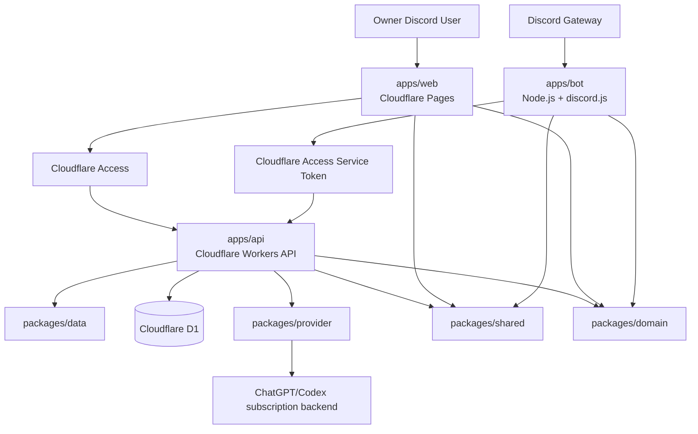
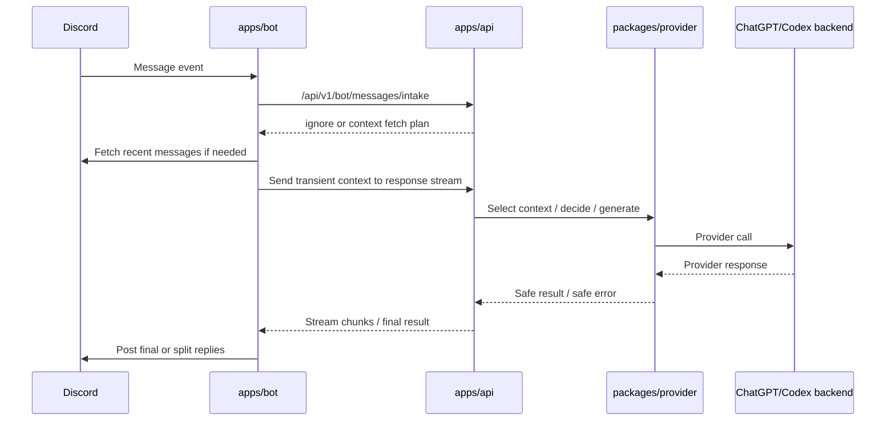

# dc-chatbot

`dc-chatbot` は、Discord の Private Bot から ChatGPT/Codex subscription-backed backend を利用するためのアプリケーションです。

Owner Discord User は自分の ChatGPT Subscription Connection を接続し、Registered Member は自分に割り当てられた Owner Discord User の ChatGPT Subscription Connection を使って bot を利用します。

## 設計ドキュメント

実装判断の正は ADR とドメイン用語集です。

- `CONTEXT.md` — ドメイン用語と避けたい表現
- `docs/adr/README.md` — ADR 索引
- `docs/adr/*.md` — 個別の設計決定
- `AGENTS.md` — このリポジトリで作業する AI agent / developer 向けルール

新しい実装判断が既存 ADR と矛盾する場合は、実装へ黙って合わせず、ADR の追加または更新を先に検討してください。

## 本実装の目標構成

本実装は pnpm workspace の monorepo として、実行単位の `apps/*` と共有ライブラリの `packages/*` を分けます。

```text
.
├── apps/
│   ├── api/                    # Cloudflare Workers API
│   ├── web/                    # Cloudflare Pages frontend: Vite + React + React Router + Tailwind CSS + shadcn/ui
│   ├── bot/                    # Discord Bot Worker: Node.js + discord.js
│   └── api-spike/              # Drizzle + D1 検証用。production 実装の責務は持たない
├── packages/
│   ├── shared/                 # API/Web/Bot で共有する DTO と Valibot schemas
│   ├── domain/                 # ドメイン型、用語、状態遷移、policy helper
│   ├── data/                   # Drizzle ORM + D1 schema、hand-written forward-only migrations、repository helper
│   ├── provider/               # ChatGPT/Codex subscription backend adapter
│   └── config/                 # 共通 tsconfig / lint / format 設定が必要になれば配置
├── docs/
│   └── adr/                    # Architecture Decision Records
├── CONTEXT.md                  # ドメイン用語集
├── AGENTS.md                   # 作業ルール
├── package.json                # workspace root scripts
├── pnpm-workspace.yaml         # apps/* と packages/*
└── tsconfig.base.json          # 共通 TypeScript 設定
```

上記のうち、現時点で存在する `apps/api-spike` は Drizzle + D1 compatibility/reference spike です。本実装の package 境界・runtime 境界・認可境界は `apps/api` / `apps/web` / `apps/bot` / `packages/*` 側で表現します。

## コンポーネント責務

### `apps/api` — Cloudflare Workers API

API は application boundary です。Elysia を Cloudflare Workers 互換で使い、D1、credential handling、provider calls、authorization、audit、retention cleanup をここに集約します。

主な責務:

- Cloudflare Access user identity の検証
- Owner role / member access の検証
- Bot Worker service identity の検証
- `/api/v1/owner/*` と `/api/v1/bot/*` の提供
- D1 への operational state / metadata 保存
- ChatGPT Subscription Connection credential の暗号化・復号・refresh
- Provider adapter を通した ChatGPT/Codex backend 呼び出し
- request audit / provider audit / setting audit の metadata-only 記録
- scheduled cleanup による retention enforcement

API 実装ルール:

- Cloudflare Workers 互換を維持し、Bun 固有 API に依存しません。
- Provider-specific protocol や token handling は `packages/provider` の adapter 境界へ閉じ込めます。
- Discord message content、prompt、response text、attachment URL/bytes、provider raw body を保存・ログ出力しません。

### `apps/web` — Cloudflare Pages frontend

Web は Vite + React + React Router + Tailwind CSS + shadcn/ui を使う Owner Discord User 向けの management UI です。Cloudflare Access の外側境界に加え、API 側の owner role check を前提にします。

主な画面領域:

- Owner / connection status
- Registered Member management
- Candidate Discord User promotion
- Usage / request audit metadata graph
- Model settings
- Prompt settings metadata
- Automated Trigger Source settings
- reconnect reminder / owner notification 操作

Web 実装ルール:

- credential material、prompt body history、Discord message content、response text を frontend state に保持しません。
- Admin Owner と Regular Owner の権限差を UI と API の両方で扱います。
- Registered Member は MVP では management web にログインしません。

### `apps/bot` — Discord Bot Worker

Bot Worker は Discord Gateway に接続する長寿命 Node.js process です。`discord.js` を使い、Discord イベントの intake と返信投稿を担当します。

主な責務:

- Discord Gateway 接続
- DM / guild mention / automated source のイベント受信
- Discord Message Content Intent を使った trigger message の取得
- `/api/v1/bot/messages/intake` への送信
- API から返された context fetch plan に基づく recent Discord messages の一時取得
- response stream endpoint への transient context 送信
- typing indicator、最終返信、長文分割返信
- owner notification DM の配送が API から指示された場合の実送信

Bot 実装ルール:

- D1 に直接アクセスしません。
- ChatGPT credential を保持・復号・refresh しません。
- Provider backend を直接呼びません。
- Cloudflare Access Service Token で `/api/v1/bot/*` を呼び出します。
- local development では production Bot token を使わず、dev guild / DM allowlist を必ず使います。

### `packages/shared` — DTO と runtime validation

API / Web / Bot 間の contract を共有します。

主な責務:

- hand-written DTO types
- Valibot runtime schemas
- request / response payload validation
- safe enum / status literals

Framework-specific client generation に依存せず、Cloudflare Workers bundle に載せやすい軽量 schema を優先します。

### `packages/domain` — ドメインロジック

実行環境に依存しない domain-level の型と helper を置きます。

主な候補:

- Effective ChatGPT Subscription Connection resolution
- Owner role / Regular Owner scope 判定
- Registered Member / Candidate Discord User status helper
- Response Trigger / Response Decision の安全な enum
- retention category / lifecycle category
- user-facing Japanese message の文言 helper

ここには D1 binding、Discord client、Cloudflare runtime、provider protocol を入れません。

### `packages/data` — Drizzle ORM / D1 schema / migration / data access

Drizzle ORM による D1 table schema、hand-written forward-only D1 migrations、repository/data access helper を集約します。ADR 0026 の ZenStack spike は判断材料として残し、production data layer は ADR 0056 に従って Drizzle ORM を採用します。

主な責務:

- Drizzle ORM table schema / D1 table schema
- hand-written forward-only D1 migrations
- targeted indexes
- core foreign keys
- repository / query helper
- retention cleanup query

D1 方針:

- Discord snowflake ID は `TEXT`
- audit / event / setting 系 ID は ULID text
- timestamp は ISO 8601 UTC text
- lifecycle ごとに table を分離
- production migration は forward-only

### `packages/provider` — ChatGPT/Codex provider adapter

ChatGPT/Codex subscription-backed backend との境界です。

主な責務:

- connection / refresh / revoke / needsReconnect mapping
- response generation
- vision-capable generation
- context selection / response decision provider call
- provider raw error から safe error category への変換
- provider-specific protocol と token handling の隔離

Provider adapter の外へ raw request / response body や credential details を漏らさないでください。

## Runtime 境界



## API route 境界

```text
/api/v1/owner/*    # Owner human routes
/api/v1/bot/*      # Bot Worker service routes
```

Owner routes:

- Cloudflare Access JWT を検証します。
- Access subject を Owner record に map します。
- Admin Owner / Regular Owner role を検証します。

Bot routes:

- Cloudflare Access Service Token の service identity を検証します。
- Bot Worker からの intake、context plan、response stream、notification delivery 状態更新を扱います。

## Message flow



Message content と Conversation Context は必要時に transient に処理し、D1・logs・audit・frontend state へ保存しません。

## 保存してよいもの / いけないもの

保存してよいものは原則として安全な metadata のみです。

例:

- Discord IDs / message IDs
- actor type
- event type
- status / error category
- model
- duration
- request ID / provider call ID
- attachment count / processed count / byte size metadata
- retention cleanup target timestamp

保存・ログ出力してはいけないもの:

- Discord message content
- selected Conversation Context content
- prompt body
- response text
- plaintext credential material
- ChatGPT credential history
- attachment URLs
- attachment bytes
- provider raw request / response body

## 実装順序の目安

1. `packages/shared` に DTO と Valibot schemas を定義
2. `packages/domain` に role/status/decision helper を定義
3. `packages/data` に Drizzle ORM table schema、hand-written forward-only D1 migrations、repository skeleton を定義
4. `apps/api` に owner/bot route の auth boundary と health endpoint を実装
5. `apps/bot` に intake 呼び出しと dev safety rails を実装
6. `apps/web` に Owner 管理 UI の最小 shell を実装
7. Provider adapter と credential lifecycle を API 内側から接続
8. audit metadata と scheduled cleanup を追加

## Tooling

- Node.js: `22` (`.node-version`)
- Package manager: `pnpm@10.25.0`
- Workspace: `apps/*`, `packages/*`
- TypeScript: strict mode
- lint/format: Oxlint/Oxfmt を初期方針、現 skeleton の format gate は `docs/development/tooling.md` に記録した理由で Prettier fallback

基本コマンド:

```bash
pnpm install
```

本実装 package を追加した後は、root scripts を以下のように揃える想定です。

```bash
pnpm check
pnpm build
pnpm lint
pnpm format
pnpm test
```

## `apps/api-spike` について

`apps/api-spike` は Cloudflare Workers + Drizzle + D1 の compatibility/reference spike です。production directory structure や package responsibility の中心ではありません。

本実装の production data layer は ADR 0056 に従い、Drizzle ORM + hand-written forward-only D1 migrations を採用します。ADR 0026 は ZenStack spike の判断材料として参照し、spike で確認された D1 transaction 制限を無視しないでください。
