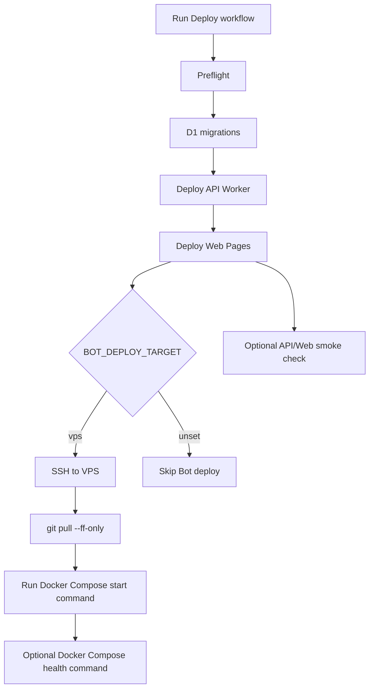

# GitHub Actions deployment runbook: Cloudflare + VPS

This runbook describes the production deployment automation for `dc-chatbot`.

- `apps/api` -> Cloudflare Workers
- `apps/web` -> Cloudflare Pages
- D1 migrations -> Cloudflare D1 through Wrangler
- `apps/bot` -> Docker Compose on a dedicated VPS by SSH, `git pull`, then `docker compose up -d --build`

`apps/api-spike` is a compatibility/reference spike and is not part of production deployment.

## 0. Safety rules

Never put the following values in repository files, GitHub Actions logs, Cloudflare logs, VPS logs, D1, frontend state, docs examples, issue comments, or PR comments:

- Discord message content
- selected Conversation Context content
- prompt body
- response text
- NVIDIA NIM API key / bearer token
- plaintext credential material
- attachment URLs or bytes
- provider raw request/response body

The Bot Worker must not receive the NVIDIA NIM API key / bearer token, D1 credentials, or provider backend credentials. It only receives Discord and Cloudflare Access Service Token runtime secrets required to call `/api/v1/bot/*`.

## 1. Deployment flow



The Cloudflare deployment is always attempted when preflight passes. Bot deployment is attempted only when `BOT_DEPLOY_TARGET=vps` is configured.

## 2. Cloudflare preparation

### 2.1 Create Cloudflare resources

1. Select the production Cloudflare account.
2. Create the production D1 database.

   ```bash
   wrangler d1 create dc-chatbot-production
   ```

3. Record the D1 database name and database ID.
4. Create or decide the API Worker name.
5. Create the Cloudflare Pages project for `apps/web`.
6. Configure the API Worker route/custom domain.
7. Configure the Web Pages custom domain.

### 2.2 Configure Cloudflare Access

Configure two Access boundaries:

1. Owner human access
   - Protects the Web app and `/api/v1/owner/*` routes.
   - Record `CF_ACCESS_TEAM_DOMAIN`.
   - Record `CF_ACCESS_AUD` for the Owner Access application.
2. Bot service access
   - Protects `/api/v1/bot/*` routes.
   - Create a Cloudflare Access Service Token.
   - Store the service token client ID and client secret as both:
     - API Worker secrets through GitHub Actions deployment.
     - VPS-local Bot runtime secrets.

The API validates Owner routes with the Access JWT and Bot routes with the service token identity.

### 2.3 Prepare Cloudflare API token

Create a Cloudflare API token for GitHub Actions with the minimum permissions needed to:

- deploy Workers
- deploy Pages
- manage Worker secrets for the API Worker
- apply D1 migrations

Store the token only as the GitHub Actions secret `CLOUDFLARE_API_TOKEN`.

## 3. VPS preparation for Bot Worker

### 3.1 OS packages

On the VPS, install:

- Git
- OpenSSH server
- Docker Engine
- Docker Compose plugin

The VPS host does not need Node.js or pnpm installed directly for the Bot runtime; the Bot image is built from `apps/bot/deploy/Dockerfile`.

### 3.2 Create a deploy user

Create a least-privilege deploy/runtime user such as `dc-chatbot`.

Recommended layout:

```text
/srv/dc-chatbot        # repository checkout
/etc/dc-chatbot/bot.env # root-readable or service-user-readable runtime env file
```

The deploy user needs write access to the repository checkout and permission to run the required Docker Compose commands. Docker group membership is effectively host-level privilege, so keep this user dedicated to deployment and restrict SSH access.

### 3.3 Clone the repository once

On the VPS:

```bash
git clone <repository-url> /srv/dc-chatbot
cd /srv/dc-chatbot
docker compose -f apps/bot/deploy/compose.production.yml build bot
docker compose -f apps/bot/deploy/compose.production.yml up -d bot
```

Use the actual repository URL. Do not paste secrets into shell history.

### 3.4 Configure Bot runtime secrets on the VPS

Create a VPS-local environment file for the Bot service. Do not commit this file.

Required production environment variables:

```text
DC_CHATBOT_ENV=production
DISCORD_TOKEN=<production Discord Bot token>
DC_CHATBOT_API_BASE_URL=<Cloudflare API origin>
CF_ACCESS_CLIENT_ID=<Cloudflare Access Service Token client ID>
CF_ACCESS_CLIENT_SECRET=<Cloudflare Access Service Token client secret>
DC_CHATBOT_MODEL=<optional default model override>
```

Do not set these in production Bot runtime:

```text
DISCORD_DEV_TOKEN
DISCORD_DEV_GUILD_ID
DISCORD_DEV_ALLOWED_USER_IDS
DC_CHATBOT_ALLOW_DEV_BOT=true
DC_CHATBOT_ALLOW_PRODUCTION_BOT_TOKEN=true
NVIDIA_NIM_BEARER_TOKEN
ALLOW_LOCAL_AUTH_BYPASS=true
LOCAL_AUTH_BYPASS_SECRET
```

### 3.5 Configure Docker Compose

`apps/bot/deploy/compose.production.yml` is the production Compose file for the Bot container. It:

- builds `apps/bot/deploy/Dockerfile` from the repository root
- reads VPS-local runtime secrets from `/etc/dc-chatbot/bot.env`
- sets `restart: unless-stopped`
- keeps the NVIDIA NIM API key out of the Bot runtime

Recommended GitHub Actions variables:

```text
BOT_VPS_START_COMMAND=docker compose -f apps/bot/deploy/compose.production.yml up -d --build bot
BOT_VPS_HEALTH_COMMAND=docker compose -f apps/bot/deploy/compose.production.yml ps --status running bot
```

The Dockerfile runs `pnpm --filter @dc-chatbot/bot build` during image build, so Bot TypeScript/package issues fail deployment before the new container is started.

### 3.6 SSH key for GitHub Actions

1. Create a deploy-only SSH key pair for GitHub Actions.
2. Add the public key to the VPS deploy user's `authorized_keys`.
3. Restrict the key to the deploy user and, if possible, restrict network/source access.
4. Capture the VPS host key in known_hosts format from a trusted channel.
5. Store the private key and known_hosts entry in GitHub Actions Secrets.

Do not use `ssh-keyscan` inside the workflow as the trust source for production. The workflow expects a pinned `BOT_VPS_KNOWN_HOSTS` secret.

## 4. GitHub Actions configuration

Configure repository-level Actions Secrets and Variables.

### 4.1 Required Secrets for Cloudflare

| Secret                    | Purpose                                                                                      |
| ------------------------- | -------------------------------------------------------------------------------------------- |
| `CLOUDFLARE_API_TOKEN`    | Deploy Workers/Pages, upload Worker secrets, and apply D1 migrations.                        |
| `CLOUDFLARE_ACCOUNT_ID`   | Cloudflare account ID.                                                                       |
| `CF_ACCESS_CLIENT_ID`     | Cloudflare Access Service Token client ID used by API secret validation and Bot runtime.     |
| `CF_ACCESS_CLIENT_SECRET` | Cloudflare Access Service Token client secret used by API secret validation and Bot runtime. |
| `NVIDIA_NIM_BEARER_TOKEN` | NVIDIA NIM API key value for the API Worker only. Never expose it to Web, Bot, D1, or logs.  |

### 4.2 Required Variables for Cloudflare

| Variable                        | Value                                                                   |
| ------------------------------- | ----------------------------------------------------------------------- |
| `CF_ACCESS_TEAM_DOMAIN`         | Cloudflare Access team domain, for example `team.cloudflareaccess.com`. |
| `CF_ACCESS_AUD`                 | Cloudflare Access application audience tag for Owner routes.            |
| `CLOUDFLARE_D1_DATABASE_NAME`   | Production D1 database name.                                            |
| `CLOUDFLARE_D1_DATABASE_ID`     | Production D1 database ID.                                              |
| `CLOUDFLARE_PAGES_PROJECT_NAME` | Cloudflare Pages project name for `apps/web`.                           |
| `VITE_API_BASE_URL`             | Public API origin used by the Owner UI build.                           |
| `LLM_PROVIDER`                  | `nvidia_nim` for production.                                            |

Optional Cloudflare variables:

| Variable              | Purpose                                                                    |
| --------------------- | -------------------------------------------------------------------------- |
| `API_WORKER_NAME`     | Worker name override. Defaults to `dc-chatbot-api` when unset.             |
| `NVIDIA_NIM_BASE_URL` | Optional NVIDIA NIM OpenAI-compatible base URL override.                   |
| `API_SMOKE_URL`       | API origin for smoke check. The workflow checks `${API_SMOKE_URL}/health`. |
| `WEB_SMOKE_URL`       | Web origin for smoke check.                                                |

### 4.3 Required Secrets for VPS Bot deploy

These are required only when `BOT_DEPLOY_TARGET=vps`.

| Secret                    | Purpose                                        |
| ------------------------- | ---------------------------------------------- |
| `BOT_VPS_HOST`            | SSH host name or IP address of the VPS.        |
| `BOT_VPS_USER`            | SSH deploy user.                               |
| `BOT_VPS_SSH_PRIVATE_KEY` | Private key for the deploy user.               |
| `BOT_VPS_KNOWN_HOSTS`     | Pinned known_hosts entry for the VPS host key. |

Do not store `DISCORD_TOKEN` in GitHub Actions for the normal pull-and-start VPS flow. Keep it in the VPS-local service environment or secret store.

### 4.4 Required Variables for VPS Bot deploy

These are required only when `BOT_DEPLOY_TARGET=vps`.

| Variable                | Example value                                                                | Purpose                                 |
| ----------------------- | ---------------------------------------------------------------------------- | --------------------------------------- |
| `BOT_DEPLOY_TARGET`     | `vps`                                                                        | Enables the VPS Bot deploy job.         |
| `BOT_VPS_APP_DIR`       | `/srv/dc-chatbot`                                                            | Repository checkout path on the VPS.    |
| `BOT_VPS_START_COMMAND` | `docker compose -f apps/bot/deploy/compose.production.yml up -d --build bot` | Command run after `git pull --ff-only`. |

Optional VPS variables:

| Variable                 | Example value                                                                      | Purpose                                                         |
| ------------------------ | ---------------------------------------------------------------------------------- | --------------------------------------------------------------- |
| `BOT_VPS_BRANCH`         | `main`                                                                             | Branch to checkout on the VPS. Defaults to the workflow branch. |
| `BOT_VPS_PORT`           | `22`                                                                               | SSH port. Defaults to `22`.                                     |
| `BOT_VPS_HEALTH_COMMAND` | `docker compose -f apps/bot/deploy/compose.production.yml ps --status running bot` | Optional command run after start/restart.                       |

## 5. Deploy procedure

### 5.1 Before running the workflow

1. Confirm all required GitHub Actions Secrets and Variables are configured.
2. Confirm the VPS Docker Compose Bot service can start manually.
3. Confirm the VPS has production Bot runtime secrets locally.
4. Confirm `apps/api/wrangler.toml` does not enable `ALLOW_LOCAL_AUTH_BYPASS=true`.
5. Confirm D1 migrations are forward-only.
6. Run local or CI checks before merging to the deployment branch:

   ```bash
   pnpm install --frozen-lockfile
   pnpm format:check
   pnpm check
   pnpm lint
   pnpm test:unit
   pnpm test:e2e
   pnpm build
   ```

### 5.2 Run GitHub Actions deploy

1. Open the GitHub repository.
2. Open **Actions**.
3. Select **Deploy**.
4. Select **Run workflow**.
5. Choose the branch to deploy.
6. Start the workflow.

Expected job order:

1. **Deploy preflight**
2. **Apply D1 migrations**
3. **Deploy API Worker**
4. **Deploy Web Pages**
5. **Deploy Bot on VPS** when `BOT_DEPLOY_TARGET=vps`
6. **Smoke check** when `API_SMOKE_URL` and `WEB_SMOKE_URL` are configured

### 5.3 Post-deploy verification

Cloudflare:

1. Confirm D1 migrations succeeded.
2. Confirm API Worker deploy succeeded.
3. Confirm API Worker secrets were uploaded by name only; values must not appear in logs.
4. Confirm Web Pages deploy succeeded.
5. Confirm optional API/Web smoke checks passed.
6. Confirm Cloudflare logs are metadata-only.

VPS:

1. Confirm the deploy job completed `git pull --ff-only` without merge commits.
2. Confirm the Docker image build passed.
3. Confirm the configured Docker Compose start command passed.
4. If configured, confirm `BOT_VPS_HEALTH_COMMAND` passed.
5. On the VPS, inspect container status and metadata-only logs:

   ```bash
   docker compose -f apps/bot/deploy/compose.production.yml ps bot
   docker compose -f apps/bot/deploy/compose.production.yml logs --since 10m bot
   ```

Do not paste Discord message content, prompt body, response text, credential material, attachment URLs, or provider raw bodies into troubleshooting channels.

## 6. Failure handling

### 6.1 Preflight failure

Common causes:

- missing GitHub Actions Secret or Variable
- `LLM_PROVIDER` is not `nvidia_nim`
- `ALLOW_LOCAL_AUTH_BYPASS=true` is present in production Wrangler config
- `BOT_DEPLOY_TARGET` is an unsupported value
- VPS variables are missing while `BOT_DEPLOY_TARGET=vps`

Fix configuration and rerun the workflow.

### 6.2 D1 migration failure

The deployment stops before API/Web/Bot deploy.

- Do not add down migrations.
- Do not rollback production schema by manually reverting D1.
- Add a forward-fix migration.
- Restore from backup only as an explicit operator incident procedure.

### 6.3 API deploy failure

Check:

- `@dc-chatbot/api` build output
- Cloudflare API token permissions
- patched `apps/api/wrangler.toml` values
- D1 binding name and ID
- Cloudflare Access variables

Do not print Worker secret values while debugging.

### 6.4 Web deploy failure

Check:

- `@dc-chatbot/web` build output
- `VITE_API_BASE_URL`
- Cloudflare Pages project name
- Pages custom domain and branch settings

### 6.5 Bot VPS deploy failure

Check the failed step:

- SSH connection or host key failure
  - Verify `BOT_VPS_HOST`, `BOT_VPS_USER`, `BOT_VPS_PORT`, `BOT_VPS_SSH_PRIVATE_KEY`, and `BOT_VPS_KNOWN_HOSTS`.
- `git pull --ff-only` failure
  - Remove local uncommitted changes from the VPS checkout or recreate the checkout.
- Docker image build failure
  - Verify Docker/Compose, network access, lockfile consistency, and Bot package build errors.
- start command failure
  - Verify Docker Compose configuration and the VPS-local `/etc/dc-chatbot/bot.env` file.
- health command failure
  - Inspect container status and metadata-only logs on the VPS.

### 6.6 Urgent recovery

Preferred recovery is a forward-fix commit and redeploy.

If the Bot process alone must be stopped while Cloudflare API/Web stay up:

```bash
docker compose -f apps/bot/deploy/compose.production.yml stop bot
```

If the Bot must be restarted after a VPS-side runtime fix:

```bash
docker compose -f apps/bot/deploy/compose.production.yml up -d --build bot
```

Record any manual operator action in the incident notes without including sensitive content.

## 7. Rotation notes

- Rotate `NVIDIA_NIM_BEARER_TOKEN` through Cloudflare Worker secret deployment. It is not used by the Bot VPS.
- Rotate `DISCORD_TOKEN` on the VPS-local service environment and restart the Bot service.
- Rotate Cloudflare Access Service Token in both API Worker secrets and VPS-local Bot runtime secrets.
- Rotate `BOT_VPS_SSH_PRIVATE_KEY` by updating the VPS authorized key and GitHub Actions secret.
- Update `BOT_VPS_KNOWN_HOSTS` only after verifying the VPS host key through a trusted channel.
